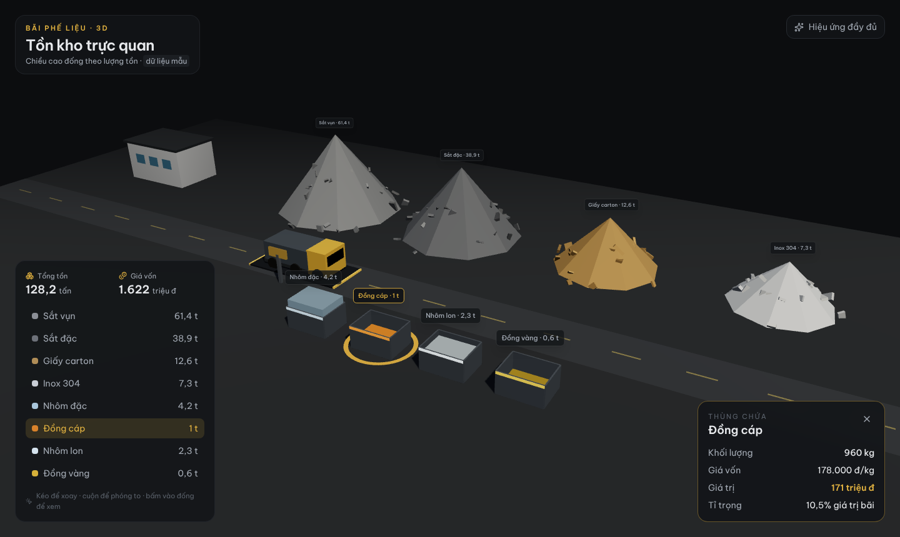
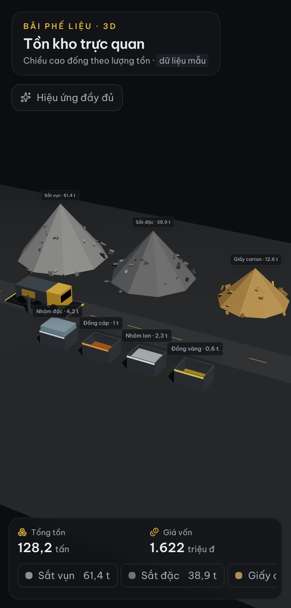

<div align="center">

# Bãi phế liệu 3D

**Xem tồn kho bãi phế liệu dưới dạng cảnh 3D tương tác: đống càng cao là hàng càng nhiều.**

[](https://github.com/ferbdev-byte/scrap-yard-3d/actions/workflows/ci.yml)
[](https://ferbdev-byte.github.io/scrap-yard-3d/)


[](LICENSE)

### [▶ Mở bản demo](https://ferbdev-byte.github.io/scrap-yard-3d/)



</div>

## Ý tưởng

Bảng tồn kho dạng số khó cho thấy *bãi đang đầy chỗ nào*. Ở đây mỗi loại phế liệu là một vật thể trong bãi:

- **Hàng đổ đống** (sắt, inox, giấy) là hình nón. Chiều cao tính theo **căn bậc ba khối lượng**: thể tích nón tăng theo lập phương chiều cao, nên đống 8 lần nặng hơn chỉ cao gấp đôi, đúng như nhìn ngoài đời.
- **Hàng giá trị cao** (đồng, nhôm) nằm trong thùng; mức hàng trong thùng là tỉ lệ so với sức chứa.
- Bấm vào đống hoặc chọn trong danh sách để xem khối lượng, giá vốn, giá trị và tỉ trọng trong tổng giá trị bãi.

Số liệu trong demo là **dữ liệu mẫu**.

## Điểm kỹ thuật

| | |
|---|---|
| **Bố cục tự động** | `layoutYard()` xếp đống theo hàng, thùng theo giá trị, luôn chừa lối xe chạy. Unit test kiểm tra không có hai vật thể chồng nhau và lối xe luôn trống. |
| **Hiệu năng** | three.js tách thành chunk riêng và tải lười: chữ và bảng số hiện ngay (~15 KB), cảnh 3D tải sau. Mảnh vụn dùng hạt ngẫu nhiên cố định nên không đổi hình mỗi lần render. |
| **Giảm hiệu ứng** | Tự bật theo `prefers-reduced-motion`, nhớ lựa chọn qua lần tải sau. Tắt bóng đổ, khử răng cưa, chuyển động; `frameloop="demand"` nên GPU nghỉ khi không thao tác. |
| **Truy cập** | Mọi thao tác trong cảnh 3D đều có đường tương đương bằng bàn phím: danh sách nút có `aria-pressed`, thẻ chi tiết là `dialog`, `Esc` để đóng. |
| **Điện thoại** | Máy quay lùi xa hơn trên màn hình dọc, danh sách thành dải cuộn ngang, thẻ chi tiết thay chỗ danh sách khi mở. |

<p align="center"></p>

## Kiểm thử

- **Unit test** (Vitest): chiều cao đống, mức thùng, bố cục không chồng, lối xe trống, tổng tồn.
- **E2E** (Playwright) trên cả máy tính và điện thoại: cảnh 3D thật sự được vẽ (kiểm tra điểm ảnh của canvas), chọn bằng bàn phím, `Esc`, chế độ giảm hiệu ứng nhớ qua lần tải lại, tôn trọng `prefers-reduced-motion`, không tràn ngang, có ảnh Open Graph, không có lỗi JavaScript.
- Máy CI không có GPU nên WebGL chạy bằng SwiftShader (render bằng CPU).

## Chạy trên máy

```bash
npm ci
npm run dev        # http://localhost:5173
npm test           # unit test
npm run e2e        # E2E (lần đầu: npx playwright install chromium)
npm run build
```

## Công nghệ

React 19 · TypeScript · Vite · React Three Fiber · drei · Tailwind CSS v4 · Vitest · Playwright · GitHub Actions + Pages

## Giấy phép

[MIT](LICENSE)
